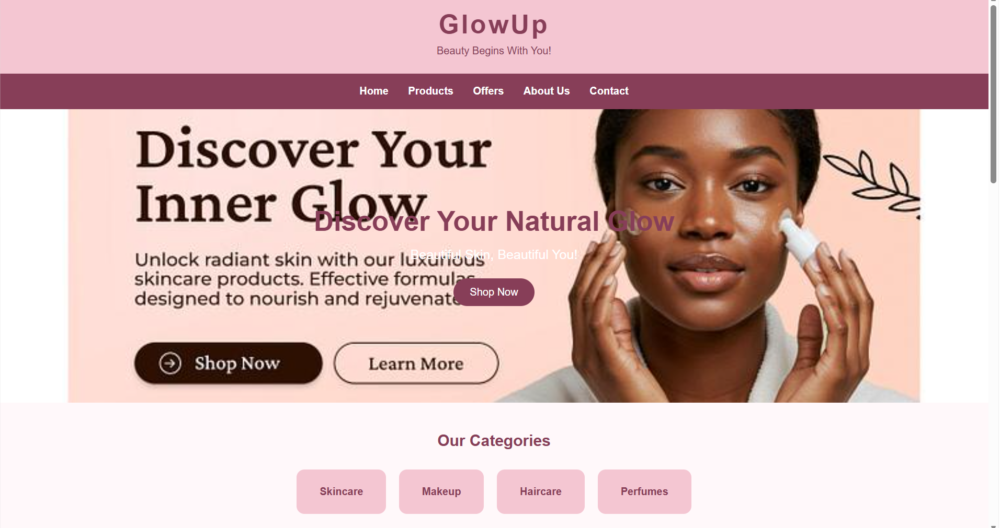

# Ex02 Commercial Website
## Date: 31-10-26

## AIM
To create a commercial website using CSS Flexbox.

## ALGORITHM
### STEP 1
Create an HTML file (index.html)

### STEP 2
Create a CSS file (style.css)

### STEP 3
Include a navigation bar with links to different sections.

### STEP 4
Add structured sections for Homepage, Products / Services, About Us, Contact Details and User Account.

### STEP 5
Include social media links at the footer with copyright information.

### STEP 6
Define global styles for fonts, colors, and layout.

### STEP 7
Style the header, navigation bar, and sections.

### STEP 8
Use Flexbox for layout design.

### STEP 9
Add hover effects and transitions for interactivity.

### STEP 10
Add Images and Media.

### STEP 11
Use optimized images for a professional look.

### STEP 12
Open the HTML file in a browser to check layout and functionality.

### STEP 13
Fix styling issues and refine content placement.

### STEP 14
Deploy the website.

### STEP 15
Upload to GitHub Pages for free hosting.

## PROGRAM

```

<!DOCTYPE html>
<html lang="en">
<head>
    <meta charset="UTF-8">
    <meta name="viewport" content="width=device-width, initial-scale=1.0">
    <title>GlowUp Beauty Store</title>
    <link rel="stylesheet" href="style.css">
</head>
<body>

    <!-- Header -->
    <header>
        <h1>GlowUp</h1>
        <p>Beauty Begins With You!</p>
    </header>

    <!-- Navigation -->
    <nav>
        <a href="#home">Home</a>
        <a href="#products">Products</a>
        <a href="#offers">Offers</a>
        <a href="#about">About Us</a>
        <a href="#contact">Contact</a>
    </nav>

    <!-- Home -->
    <section id="home" class="hero">
        <div>
            <h2>Discover Your Natural Glow</h2>
            <p>Beautiful Skin, Beautiful You!</p>
            <a href="#products" class="btn">Shop Now</a>
        </div>
    </section>

    <!-- Categories -->
    <section class="categories">
        <h2>Our Categories</h2>

        <div class="category-container">
            <div class="category">Skincare</div>
            <div class="category">Makeup</div>
            <div class="category">Haircare</div>
            <div class="category">Perfumes</div>
        </div>
    </section>

    <!-- Products -->
    <section id="products">
        <h2>Our Best Selling Products</h2>

        <div class="product-container">

            <div class="product">
                
                <h3>Skin Care Cream</h3>
                <p>₹499</p>
                <button>Buy Now</button>
            </div>

            <div class="product">
                
                <h3>Luxury Lipstick</h3>
                <p>₹299</p>
                <button>Buy Now</button>
            </div>

            <div class="product">
                
                <h3>Makeup Kit</h3>
                <p>₹899</p>
                <button>Buy Now</button>
            </div>

            <div class="product">
                
                <h3>Premium Perfume</h3>
                <p>₹699</p>
                <button>Buy Now</button>
            </div>

        </div>
    </section>

    <!-- Offers -->
    <section id="offers" class="offers">
        <h2>Special Beauty Offers!</h2>
        <p>Get Up To 30% OFF on Selected Products</p>
        <a href="#products" class="btn">Explore Now</a>
    </section>

    <!-- About -->
    <section id="about">
        <h2>About Us</h2>
        <p>
            GlowUp is your favourite beauty destination.
            We provide quality skincare, makeup and beauty
            products at affordable prices. Our mission is to
            make everyone feel confident and beautiful.
        </p>
    </section>

    <!-- Contact -->
    <section id="contact">
        <h2>Contact Us</h2>
        <p>Email: glowup@gmail.com</p>
        <p>Phone: 9876543210</p>
        <p>Location: Chennai, Tamil Nadu</p>
    </section>

    <!-- User Account -->
    <section id="account">
        <h2>User Account</h2>
        <p>Join us to enjoy exclusive beauty offers!</p>
        <button>Login / Sign Up</button>
    </section>

    <!-- Footer -->
    <footer>
        <h2>GlowUp</h2>
        <p>Follow Us: Instagram | Facebook | Pinterest</p>
        <p>© 2026 GlowUp. All Rights Reserved.</p>
    </footer>

</body>
</html>


```
```

/* Global Styles */
* {
    margin: 0;
    padding: 0;
    box-sizing: border-box;
}

html {
    scroll-behavior: smooth;
}

body {
    font-family: Arial, sans-serif;
    background-color: #fff8fa;
    color: #444;
}

/* Header */
header {
    background-color: #f4c6d2;
    color: #873e58;
    text-align: center;
    padding: 25px;
}

header h1 {
    font-size: 40px;
    letter-spacing: 3px;
}

header p {
    margin-top: 8px;
}

/* Navigation */
nav {
    display: flex;
    justify-content: center;
    align-items: center;
    flex-wrap: wrap;
    gap: 30px;
    background-color: #873e58;
    padding: 18px;
}

nav a {
    color: white;
    text-decoration: none;
    font-weight: bold;
    transition: 0.3s;
}

nav a:hover {
    color: #ffd6e2;
}

/* Hero Section */
.hero {
    height: 450px;
    background-image: url("images/ii.jpeg");

    background-size: cover;
    background-position: center;

    display: flex;
    justify-content: center;
    align-items: center;
    text-align: center;
    color: white;
}

.hero h2 {
    font-size: 42px;
    margin-bottom: 15px;
}

.hero p {
    font-size: 20px;
    margin-bottom: 25px;
}

/* Buttons */
.btn {
    display: inline-block;
    background-color: #873e58;
    color: white;
    text-decoration: none;
    padding: 12px 25px;
    border-radius: 25px;
    transition: 0.3s;
}

.btn:hover {
    background-color: #c46b89;
}

button {
    background-color: #873e58;
    color: white;
    border: none;
    padding: 10px 22px;
    margin-top: 12px;
    border-radius: 20px;
    cursor: pointer;
    transition: 0.3s;
}

button:hover {
    background-color: #c46b89;
}

/* Common Sections */
section {
    padding: 45px 7%;
    text-align: center;
}

section h2 {
    color: #873e58;
    margin-bottom: 30px;
}

/* Categories */
.category-container {
    display: flex;
    justify-content: center;
    flex-wrap: wrap;
    gap: 20px;
}

.category {
    background-color: #f4c6d2;
    color: #873e58;
    padding: 25px 35px;
    border-radius: 12px;
    font-weight: bold;
    transition: 0.3s;
}

.category:hover {
    background-color: #873e58;
    color: white;
    transform: translateY(-5px);
}

/* Products */
.product-container {
    display: flex;
    justify-content: center;
    flex-wrap: wrap;
    gap: 25px;
}

.product {
    background-color: white;
    width: 230px;
    padding: 15px;
    border-radius: 12px;
    box-shadow: 0 3px 12px #e8cbd4;
    transition: 0.3s;
}

.product:hover {
    transform: translateY(-8px);
}

.product img {
    width: 100%;
    height: 190px;
    object-fit: cover;
    border-radius: 10px;
}

.product h3 {
    color: #873e58;
    margin: 15px 0 8px;
}

.product p {
    color: #c46b89;
    font-weight: bold;
}

/* Offers */
.offers {
    background-color: #f8dce5;
}

.offers p {
    margin-bottom: 25px;
    font-size: 18px;
}

/* About */
#about p {
    max-width: 750px;
    margin: auto;
    line-height: 1.8;
}

/* Contact */
#contact {
    background-color: #fff0f4;
    line-height: 2;
}

/* Footer */
footer {
    background-color: #873e58;
    color: white;
    text-align: center;
    padding: 25px;
    line-height: 2;
}

footer h2 {
    color: white;
}

/* Responsive Design */
@media (max-width: 600px) {

    nav {
        gap: 15px;
    }

    .hero h2 {
        font-size: 28px;
    }

    .product {
        width: 100%;
        max-width: 300px;
    }
}
```

## OUTPUT




## RESULT
The program for creating commercial website using CSS Flexbox is executed successfully.